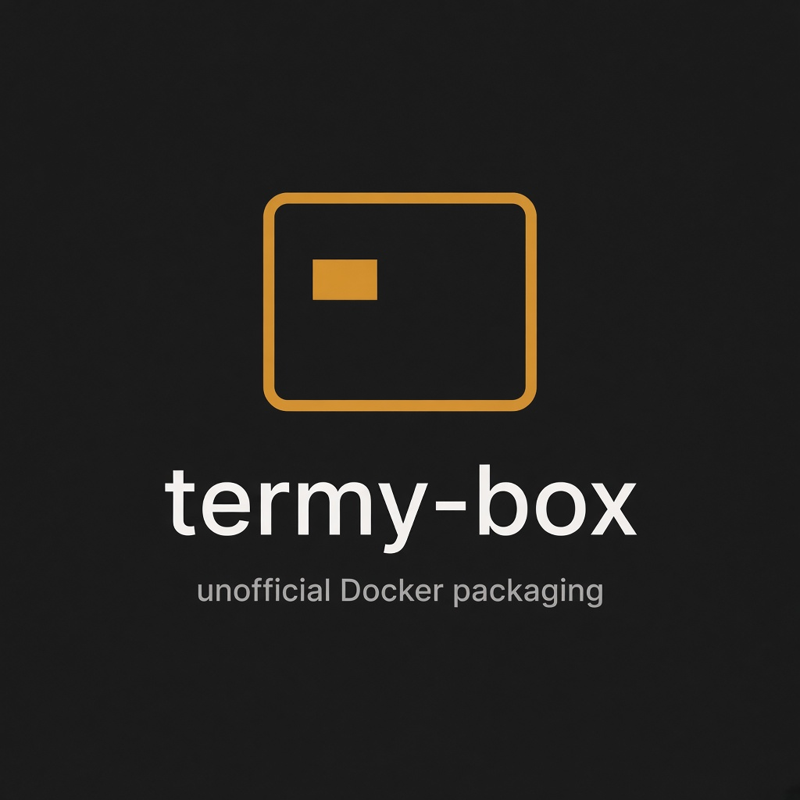
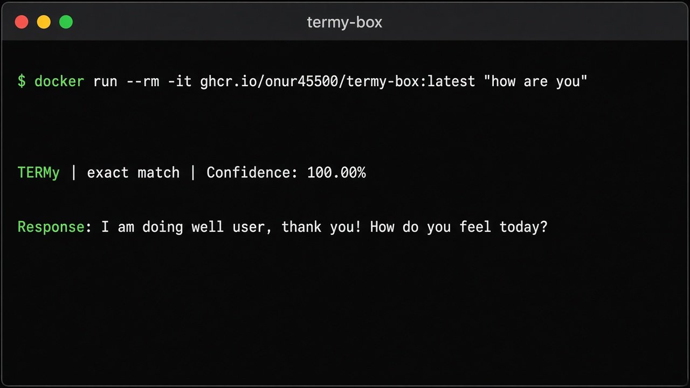
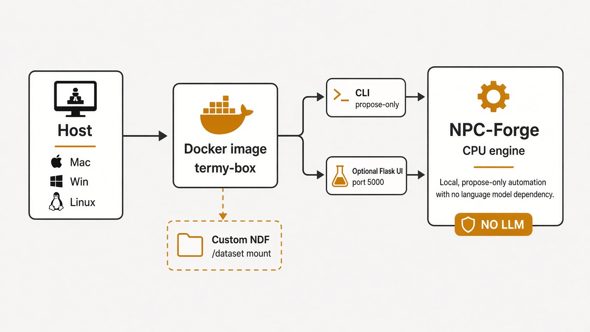
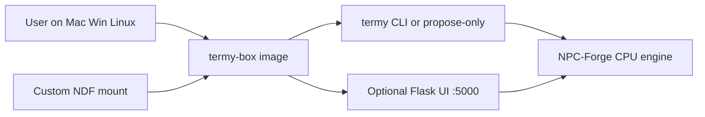

<p align="center">
  
</p>

# termy-box

**Unofficial community Docker packaging** of [NPC-Forge](https://github.com/gioblu/NPC-Forge) / [TERMy](https://github.com/gioblu/NPC-Forge/tree/main/npcs/termy) — a deterministic, CPU-only terminal assistant that turns natural language into shell commands **without LLMs, embeddings, or ML**.

[](https://github.com/Onur45500/termy-box/actions/workflows/docker-publish.yml)
[](LICENSE)
[](https://github.com/Onur45500/termy-box/pkgs/container/termy-box)

Not a fork. Not affiliated with the upstream maintainer. Pin + wrap so Mac, Windows, and Linux users can try TERMy without WSL or `setup.sh` pain.

---

## Try it in 30 seconds

**Published image** (after GHCR publish from this repo):

```bash
docker run --rm -it ghcr.io/onur45500/termy-box:latest "how are you"
```

**Local build** (always works from a clone):

```bash
bash scripts/fetch-upstream.sh
docker compose --env-file versions.env build
docker run --rm -it termy-box:local "how are you"
```

Safer (print proposed commands, never execute them):

```bash
docker run --rm -it -e TERMY_PROPOSE_ONLY=1 ghcr.io/onur45500/termy-box:latest "list files"
```

<p align="center">
  
</p>

---

## Table of contents

- [What this is / isn’t](#what-this-is--isnt)
- [How it fits together](#how-it-fits-together)
- [Usage](#usage)
- [Compose profiles](#compose-profiles)
- [Custom datasets](#custom-datasets)
- [Security](#security)
- [Build and pin](#build-and-pin)
- [Verify published images](#verify-published-images)
- [FAQ](#faq)
- [Credits and license](#credits-and-license)
- [Contributing](#contributing)

---

## What this is / isn’t

| This project **is** | This project **is not** |
|---------------------|-------------------------|
| A reproducible Docker image around pinned NPC-Forge/TERMy | A fork of TERMy’s engine |
| A zero-friction try path for Mac / Windows / Linux | An official NPC-Forge release |
| Propose-only + dataset mount helpers | An LLM / cloud assistant |

Original Show HN: [TERMy – A fast terminal assistant that does not use LLMs](https://news.ycombinator.com/item?id=49562219).

---

## How it fits together

<p align="center">
  
</p>



- Runs as non-root user `termy`
- One-shot CLI by default; optional web UI on port `5000`
- Custom NDF files mount at `/dataset`

---

## Usage

### One-shot

```bash
docker run --rm -it ghcr.io/onur45500/termy-box:latest "list files"
```

Use `-it` so TERMy can ask Yes/No when permission is `ask`. Pipe mode:

```bash
echo "how are you" | docker run --rm -i ghcr.io/onur45500/termy-box:latest
```

### Propose-only (recommended with host mounts)

Resolves the intent **in-process** and prints proposed commands — **never executes** them (including NDF `permission: yolo`). Refuses `--yes`.

```bash
docker run --rm -it -e TERMY_PROPOSE_ONLY=1 ghcr.io/onur45500/termy-box:latest "list files"
# equivalent:
docker run --rm -it ghcr.io/onur45500/termy-box:latest propose "list files"
```

### Interactive shell

```bash
docker run --rm -it ghcr.io/onur45500/termy-box:latest
termy how are you
```

### Web UI

```bash
docker compose --env-file versions.env up termy-server
# open http://localhost:5000/termy/chat/
```

---

## Compose profiles

Always pass `--env-file versions.env`.

| Profile | Service | Host mount | Executes commands? |
|---------|---------|------------|--------------------|
| *(default)* | `termy` | `./dataset` only | yes, after confirm / yolo |
| `workspace` | `termy-workspace` | `${TERMY_WORKSPACE:-.}` | **no** (propose-only) |
| `workspace-exec` | `termy-workspace-exec` | `${TERMY_WORKSPACE:-.}` | **yes** — dangerous |

```bash
docker compose --env-file versions.env run --rm termy "how are you"

docker compose --env-file versions.env --profile workspace \
  run --rm termy-workspace "list files"
```

---

## Custom datasets

Drop `dataset_*.json` / `templates_*.json` into `./dataset/` (or one subdirectory). See upstream [NDF docs](https://github.com/gioblu/NPC-Forge/blob/main/docs/dataset.md).

```bash
cp examples/dataset/*.json dataset/
bash scripts/validate-dataset.sh examples/dataset

docker compose --env-file versions.env run --rm \
  -v "$PWD/examples/dataset:/dataset:ro" \
  termy "termy box example ping"
```

Details: [`examples/dataset/README.md`](examples/dataset/README.md).

---

## Security

> TERMy can run real shell commands. A container only isolates your host if you **do not** mount directories you care about. Prefer propose-only / profile `workspace` before `workspace-exec`. Never use `--privileged`.

Full policy: [`SECURITY.md`](SECURITY.md).

---

## Build and pin

**Single source of truth:** [`versions.env`](versions.env).

```bash
# edit NPC_FORGE_REF in versions.env, then:
bash scripts/fetch-upstream.sh
docker compose --env-file versions.env build
```

Weekly CI may open an upstream-bump PR — never auto-merges.

Maintainer publish steps: [`docs/RELEASING.md`](docs/RELEASING.md).

---

## Verify published images

CI attaches SBOM + provenance and cosign-signs tags on push to `main` / `v*`.

```bash
docker buildx imagetools inspect ghcr.io/onur45500/termy-box:latest

cosign verify \
  --certificate-identity-regexp 'https://github.com/Onur45500/termy-box/.*' \
  --certificate-oidc-issuer https://token.actions.githubusercontent.com \
  ghcr.io/onur45500/termy-box:latest
```

---

## FAQ

**Why does upstream say Linux/WSL only?**  
Bare-metal install targets Linux. This image gives everyone else a containerized try path.

**Why `-it`?**  
Without a TTY, TERMy may read stdin instead of argv, and Yes/No confirms need a terminal. Propose-only does not need confirms because it never executes.

**Does propose-only stop `yolo`?**  
Yes. It uses the engine in-process and never runs tool commands.

**Apple Silicon?**  
Multi-arch `linux/amd64` + `linux/arm64`. If needed: `--platform linux/amd64`.

**Where do I report TERMy intent bugs?**  
Upstream: https://github.com/gioblu/NPC-Forge — packaging issues belong here.

---

## Credits and license

- Upstream: [gioblu/NPC-Forge](https://github.com/gioblu/NPC-Forge) by Giovanni Blu Mitolo
- Show HN: https://news.ycombinator.com/item?id=49562219
- This packaging: **AGPL-3.0** ([`LICENSE`](LICENSE)) to match upstream

**AGPL note (not legal advice):** shipping an image with unmodified AGPL code is generally conveyance — we include the license, attribution, and source labels. Confirm obligations with a lawyer for wide redistribution or hosted services.

---

## Contributing

See [`CONTRIBUTING.md`](CONTRIBUTING.md) and [`CODE_OF_CONDUCT.md`](CODE_OF_CONDUCT.md). Changelog: [`CHANGELOG.md`](CHANGELOG.md).

Issues and PRs for packaging, docs, and CI are welcome. For TERMy behavior and datasets, go upstream.
